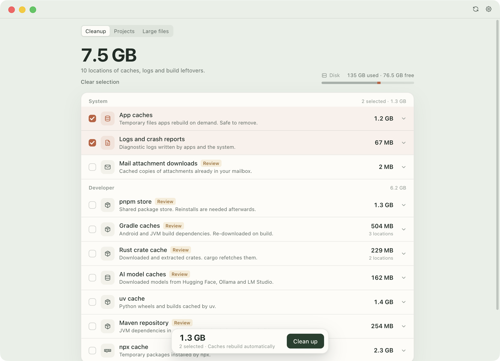

# CacheNook

Git-aware cleanup for developer caches on macOS.

CacheNook finds the build junk that accumulates inside real projects, shows exactly what it will remove, and runs a weekly sweep that refuses to touch repos you are still working on.



## Why another cleaner

General cleaners are good at system caches and Xcode. They do not know that `node_modules` belongs to a repo with uncommitted changes, or that a stale `.venv` is safer to remove than an active one. CacheNook is built around that distinction:

- It scans **project folders**, not just app caches.
- It skips repos with uncommitted changes.
- It supports per-project exclusions and `.cachenookignore`.
- It previews every scheduled cleanup and keeps a history.
- It also cleans AI model caches, which are often tens of gigabytes.

## Features

### Project artifacts

Scans your configured project roots for regenerable folders:

`node_modules`, `.next`, `.nuxt`, `.svelte-kit`, `.turbo`, `.parcel-cache`, `.expo`, `.venv`, `venv`, `__pycache__`, `.pytest_cache`, `target`, `.dart_tool`, `.gradle`, `.terraform`, `.angular`, `.nx`, `.vite`, `.nyc_output`, `.mypy_cache`, `.ruff_cache`, `.tox`, `.nox`, `coverage`, `.build`, `Pods`, `DerivedData`, `.swiftpm`, `vendor`, `dist`, `build`, `out`.

Nothing is selected by default. Review, select, delete.

### Curated caches

| Area | Examples |
| --- | --- |
| System | App caches, logs, saved state, Trash, Mail downloads, iOS backups |
| Xcode | DerivedData, device support, archives, SwiftUI previews, simulator caches |
| JavaScript | npm, pnpm, Yarn Berry, Bun, npx, Electron downloads |
| JVM and Android | Gradle, Maven |
| Python | uv, conda, `__pycache__` |
| Rust and Go | Cargo registry, Go module cache |
| AI | Hugging Face, Torch, Whisper, Ollama, LM Studio |
| Other | CocoaPods repos, Dart/Flutter pub cache, NuGet, Terraform providers |
| Tools | Homebrew old versions, Docker unused data, unavailable simulators |

Folders in `~/Library` require Full Disk Access. The app detects the grant and hides protected targets until it is available.

### Git-aware scheduling

The weekly job removes only caches from projects with no recent file changes. It also skips:

- Repos with `git status --porcelain` output
- Repos containing `.cachenookignore` (legacy `.macsweepignore` still works)
- Folders in Settings > Auto-clean exclusions

Preview first. The job records every run and posts a macOS notification when it frees space.

### Large files, history, deep clean

- **Large files**: files over a configurable threshold, with search and move-to-Trash.
- **History**: this month and all-time freed space, per run.
- **Deep clean**: review Trash in Finder, find old installers in Downloads, delete Time Machine local snapshots.

### Small things

- Menu bar icon with last cleanup, next run, scan, settings and quit.
- English and Vietnamese.
- Open at login.
- Manual update check from a JSON manifest.
- Cancel a running scan from the titlebar.

## Safety

CacheNook is deliberately conservative:

- Every cleanup path comes from a static allowlist or a configured project root.
- Project roots must resolve inside your home folder. `/`, `/System`, `~/Library` and symlinked roots are rejected.
- Symlinks are never followed. Paths are resolved before deletion and must stay inside the approved root.
- Only the contents of a cache folder are removed. The folder itself survives.
- Project deletes are hard deletes. Large files, installers and Trash review use the macOS Trash.
- Protected paths and app bundles are rejected even if a rule is wrong.
- No telemetry, no analytics, no network access unless you run an update check.
- All state stays in `~/Library/Application Support/CacheNook`.

## Install

Download the DMG from [Releases](https://github.com/ethansara92-beep/cachenook/releases/latest) and drag CacheNook into Applications.

Builds are unsigned unless the release workflow runs with a Developer ID. If Gatekeeper complains, right-click the app and choose **Open** once.

### Build from source

```bash
npm install
npm start
```

Requires macOS 13 or newer and Node 20 or newer for development.

```bash
npm test        # safety, parsers, clean engine, update logic
npm run check   # node --check across the source tree
npm run smoke   # hidden window, renders, writes /tmp/cachenook-smoke.png
npm run pack    # builds dist/CacheNook-darwin-arm64/CacheNook.app
npm run dmg     # builds dist/CacheNook-<version>.dmg
```

## Full Disk Access

macOS protects most of `~/Library`. Without Full Disk Access, CacheNook skips every target inside `~/Library` and never triggers a permission prompt. To unlock app caches, Xcode data, Mail downloads and iOS backups:

1. Open **System Settings > Privacy & Security > Full Disk Access**.
2. Add CacheNook, or the terminal you use to run `npm start`.
3. Return to the app and click **Check again**.

The detection probe reads the TCC database read-only and does not trigger a prompt.

## Scheduled cleanup

Manage it in **Settings > Automatic cleanup**:

- Toggle the job on or off
- Pick a day and time
- Set the inactivity window
- Preview, then confirm
- Show log

The LaunchAgent is `com.cachenook.stale-clean`. It runs through the app's own Electron runtime, so an external Node install is not required. Logs live in `~/Library/Logs/CacheNook`.

For automation:

```bash
npm run stale:preview
npm run stale:apply
```

## Configuration

`~/Library/Application Support/CacheNook/config.json`

```json
{
  "projectRoots": ["/Users/you/Repositories"],
  "largeFileMinMB": 300,
  "staleDays": 30,
  "staleWeekday": 0,
  "staleHour": 11,
  "staleMinute": 0,
  "autoCleanIgnore": ["/Users/you/Repositories/keep-me"],
  "language": "en",
  "updateUrl": ""
}
```

## Updates and login

- **Settings > Updates** accepts a JSON manifest URL. The app menu also has **Check for Updates…**.

```json
{
  "version": "1.0.1",
  "url": "https://example.com/CacheNook-1.0.1.dmg",
  "notes": "What changed"
}
```

The check only compares versions and opens the download link. Silent install needs a signed app and a signed update feed.

- **Open at login** starts CacheNook in the menu bar after login.

## How it differs

- **PureMac** and **Mole** are excellent general Mac cleaners. CacheNook does not try to replace them. It focuses on project-level caches and refuses to touch dirty repos.
- **npkill** is a great one-off `node_modules` CLI. CacheNook adds scheduling, review, exclusions, history and a UI.
- **CleanMyMac**, **Sensei** and **DaisyDisk** are broader paid tools. CacheNook is open source and developer-focused.
- **AI model caches**: most cleaners clear AI app logs. CacheNook can clear Hugging Face, Torch, Whisper, Ollama and LM Studio model caches when you explicitly choose them.
- **Vietnamese**: most competitors are English only.

## Architecture

```
src/main/       Electron main process, scanning, cleaning, scheduler, safety
src/preload/    contextBridge API
src/renderer/   HTML, CSS and vanilla JS UI
src/renderer/icons/  Tabler outline icons (MIT)
bin/            terminal cleanup job
test/           node:test suites
```

The scanner is read-only. A separate safety validator resolves paths and checks containment before the cleanup engine runs. See [docs/architecture.md](docs/architecture.md) and [docs/privacy.md](docs/privacy.md).

## Release and signing

The GitHub workflow builds an unsigned DMG by default. For a signed, notarized release, provide these repository secrets:

- `APPLE_CERTIFICATE_P12_BASE64`
- `APPLE_CERTIFICATE_PASSWORD`
- `DEVELOPER_ID_APPLICATION`
- `APPLE_ID`
- `APPLE_APP_SPECIFIC_PASSWORD`
- `APPLE_TEAM_ID`

See [docs/release.md](docs/release.md) for the exact `codesign`, `notarytool` and `stapler` commands.

## Contributing

Read [CONTRIBUTING.md](CONTRIBUTING.md). Please report security issues privately as described in [SECURITY.md](SECURITY.md).

## License

MIT. The Tabler icon set is MIT licensed; see the icon files for details.

CacheNook was previously developed under the name MacSweep. Existing config, history and LaunchAgent are migrated on first launch.
