# Tour tính năng

CacheNook được xây quanh một ý tưởng: công cụ dọn dẹp phải hiểu các project trên ổ, không chỉ biết cache hệ thống.

Ảnh chụp trong cửa sổ 1080 x 780. Máy demo chưa cấp Full Disk Access nên các mục trong `~/Library` bị ẩn ở ảnh Cleanup. Cấp quyền để thấy app caches, Xcode, Mail downloads và iPhone backups.

## Dọn dẹp

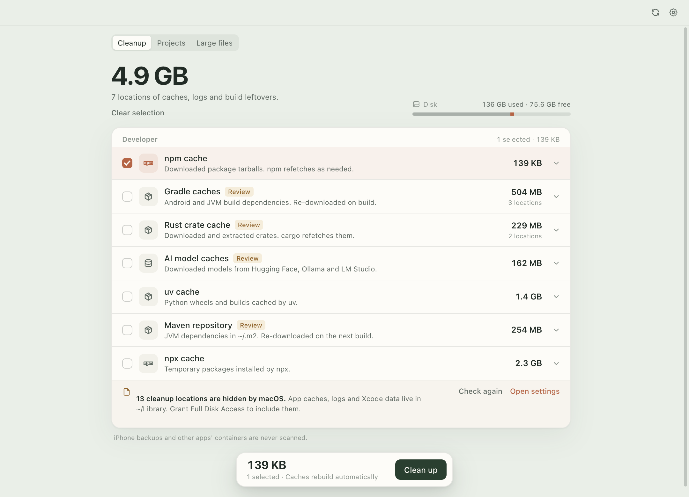

- Số lớn là tổng dung lượng có thể dọn.
- Mỗi dòng có checkbox, nhãn rủi ro và dung lượng chính xác.
- `Safe` là mục tự tạo lại được. `Review` là mục nên xem trước.
- Footer chỉ hiện khi có mục được chọn.
- Ghi chú Full Disk Access ở cuối danh sách chỉ là lối tắt, không phải lỗi.

## Chi tiết target

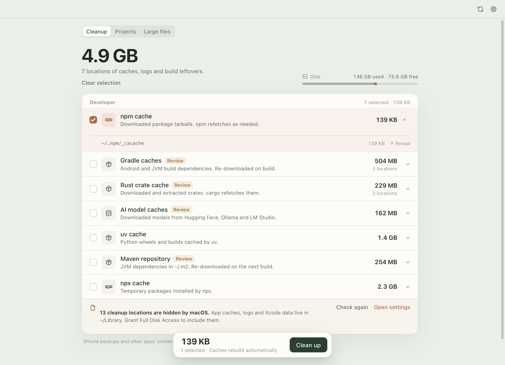

Mở rộng một dòng để xem từng root và dung lượng. `Reveal` mở thư mục trong Finder trước khi quyết định.

## Dự án

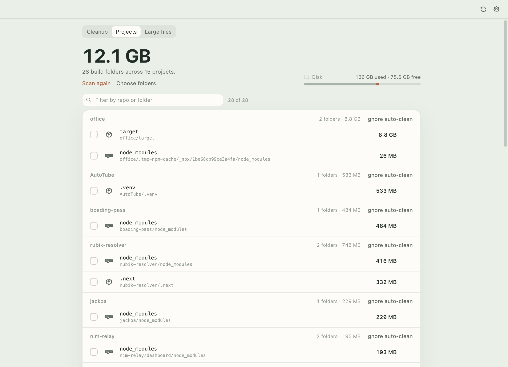

CacheNook quét các thư mục dự án để tìm build folder có thể tạo lại: `node_modules`, `.next`, `.venv`, `target`, `Pods`, `.dart_tool`, `coverage`...

- Mặc định không chọn gì.
- Header nhóm hiện tổng dung lượng của từng repo.
- `Ignore auto-clean` loại repo khỏi job định kỳ.

## Tìm trong dự án

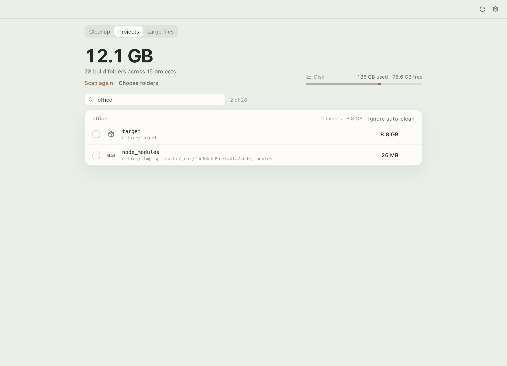

Tìm theo tên repo, artifact hoặc đường dẫn. Bộ đếm cho biết đang hiện bao nhiêu kết quả.

## File lớn

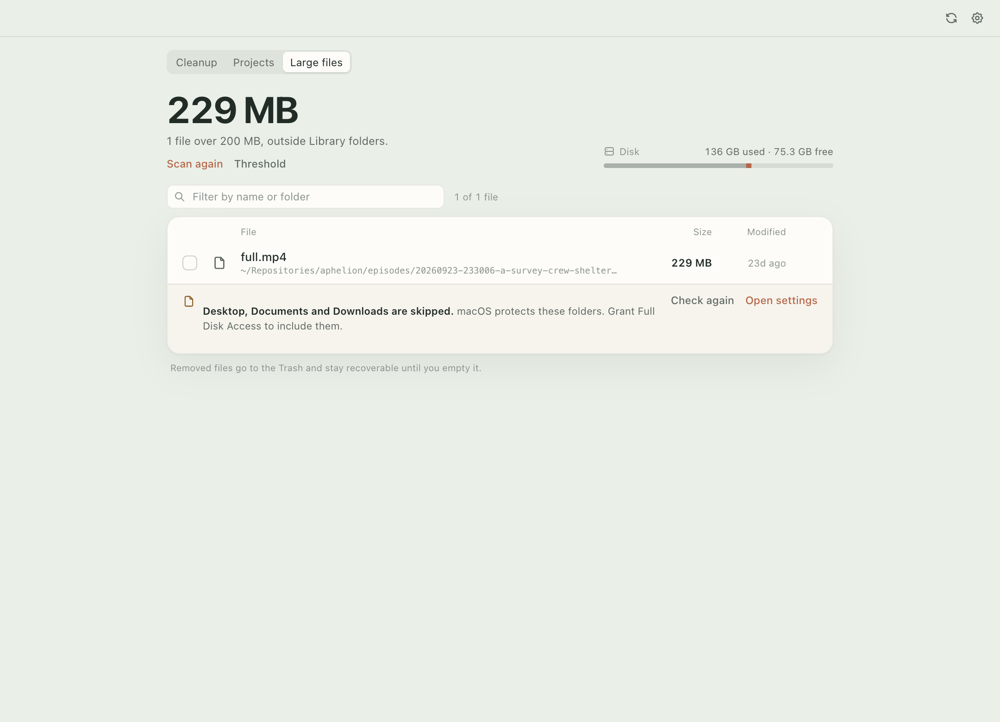

Các file trên ngưỡng, ngoài `~/Library`, `node_modules`, `.git` và app bundle.

- Tìm theo tên hoặc thư mục.
- `Reveal` mở file trong Finder.
- Xoá sẽ chuyển vào Thùng rác, vẫn khôi phục được.
- Ngưỡng chỉnh trong Cài đặt.

## Cài đặt

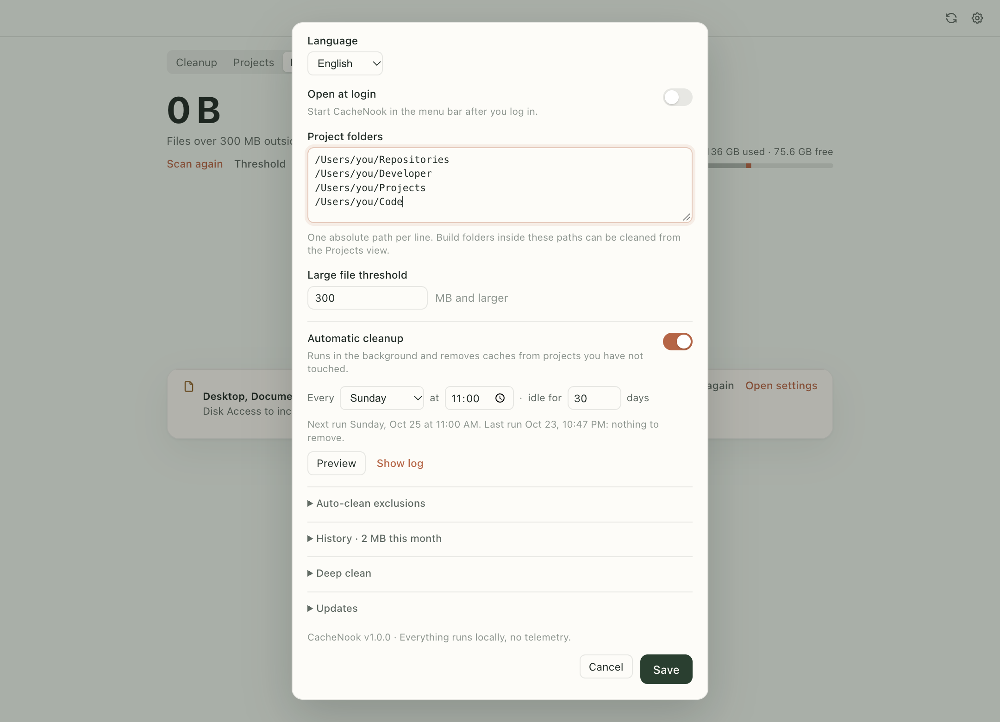

- Ngôn ngữ: English hoặc Tiếng Việt.
- Mở khi đăng nhập.
- Thư mục dự án và ngưỡng file lớn.
- Tự động dọn: ngày, giờ, số ngày không hoạt động.
- URL manifest cập nhật.

## Loại trừ

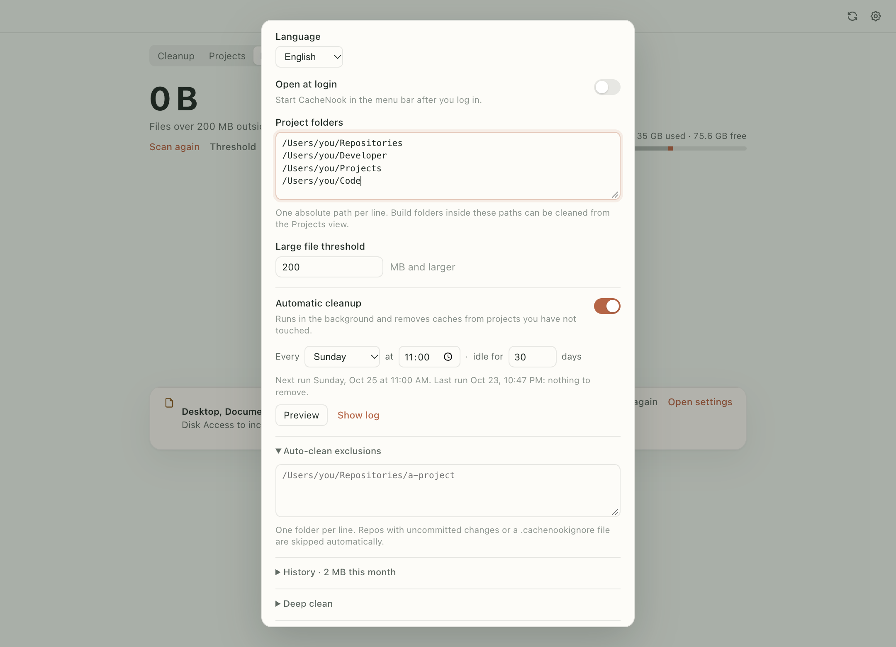

Một repo có thể được loại khỏi job định kỳ theo hai cách:

- `Ignore auto-clean` trên repo trong tab Dự án.
- Thêm đường dẫn tuyệt đối vào **Auto-clean exclusions**.

Job cũng bỏ qua repo có uncommitted changes và repo có file `.cachenookignore` (vẫn hỗ trợ `.macsweepignore` cũ).

## Lịch sử

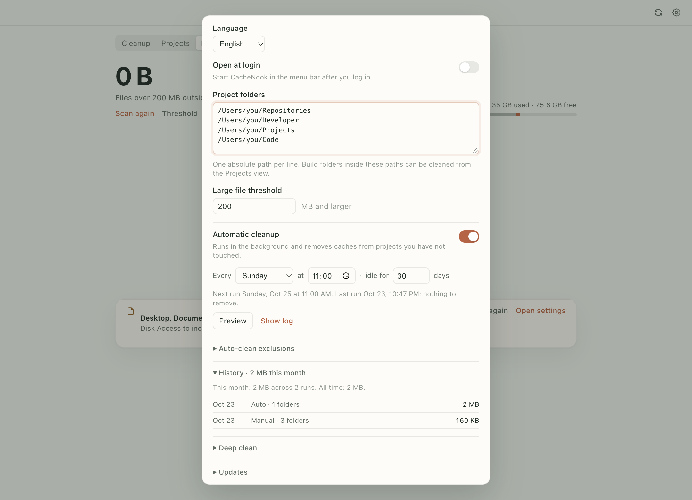

Mỗi lần dọn, tay hoặc tự động, đều được ghi lại cùng dung lượng và số thư mục. Phần tổng hợp hiện tháng này và toàn bộ.

## Dọn sâu

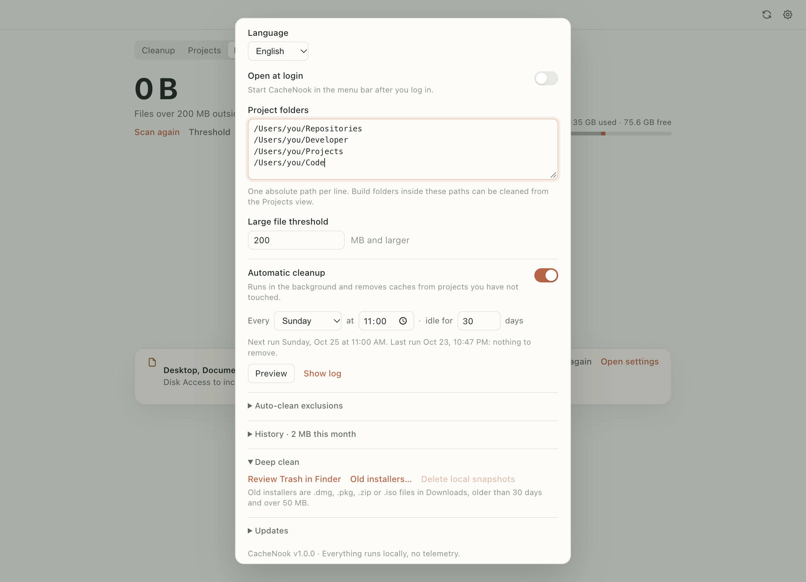

- Xem Thùng rác trong Finder trước khi dọn.
- Tìm file cài cũ `.dmg`, `.pkg`, `.zip`, `.iso` trong Downloads.
- Xoá Time Machine local snapshots.

Xoá snapshot có thể cần quyền admin. Các mục còn lại dùng Thùng rác.

## Cập nhật

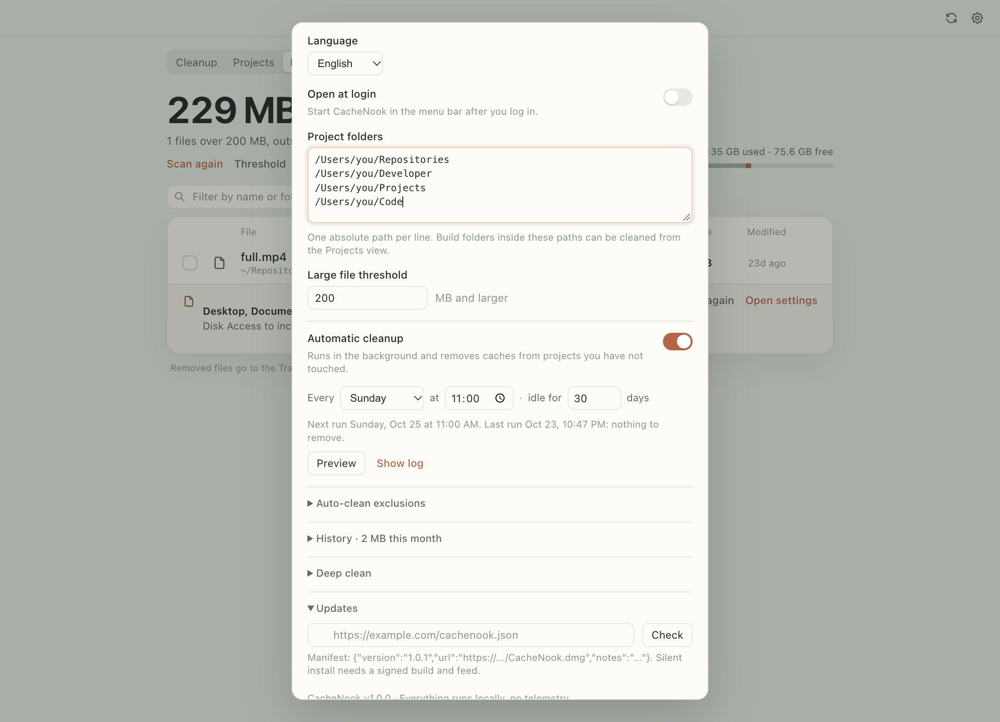

Nhập URL manifest JSON:

```json
{
  "version": "1.0.1",
  "url": "https://example.com/CacheNook-1.0.1.dmg",
  "notes": "Có gì mới"
}
```

`Check` so sánh phiên bản và hiện ghi chú. App không tự cài; muốn tự cài cần bản ký và feed ký.

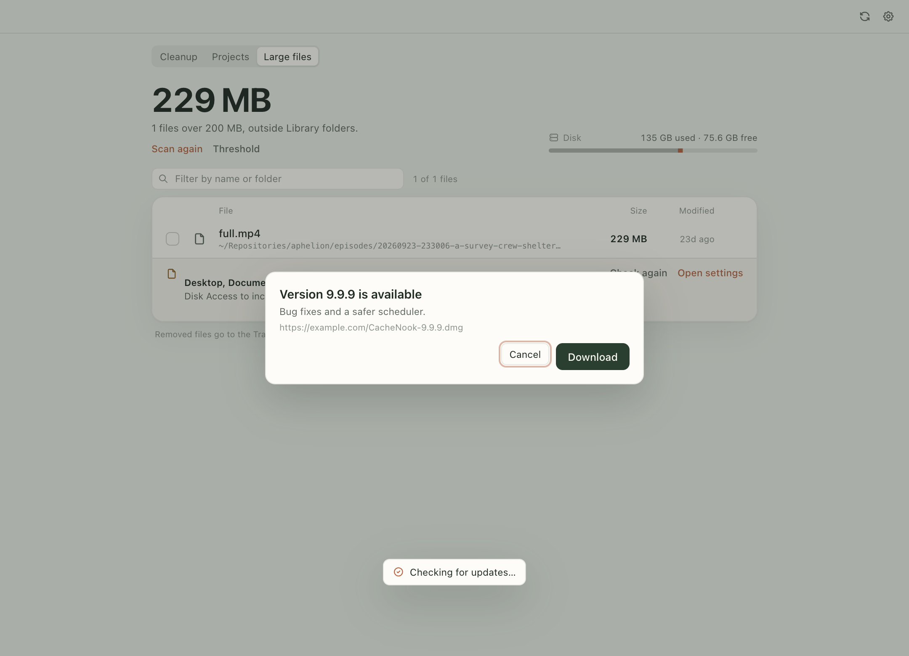

## Xem trước job định kỳ

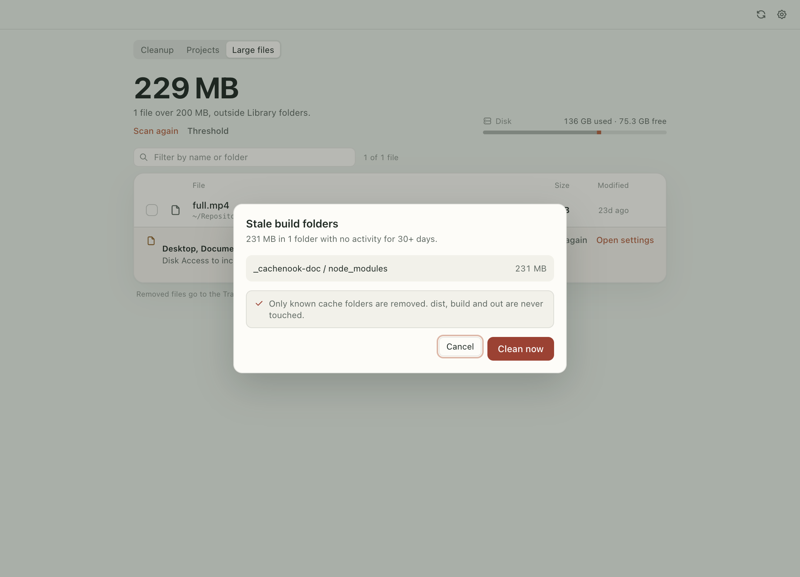

Job hàng tuần có thể xem trước. Danh sách hiện đúng thư mục, dung lượng và số ngày không hoạt động. `Clean now` hỏi lại một lần rồi chạy lại scanner, chỉ xoá những gì vẫn còn cũ.

## Tiếng Việt

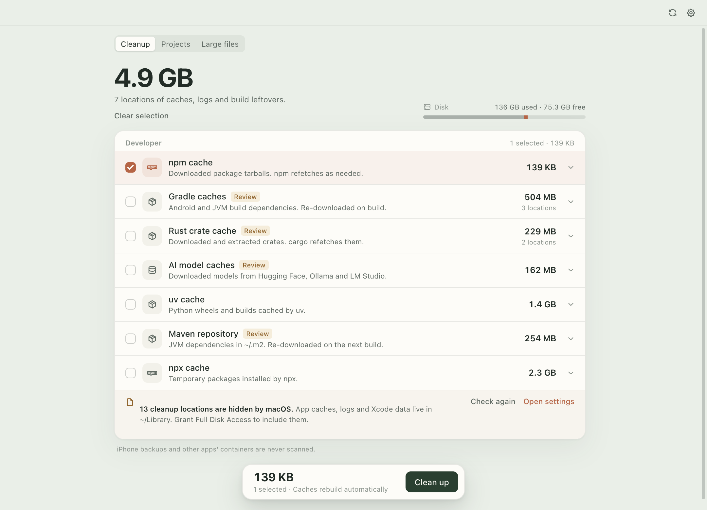

Toàn bộ giao diện, menu bar và thông báo đổi được giữa English và Tiếng Việt.

## An toàn

- Project root phải resolve vào trong home.
- Symlink được resolve và bị từ chối nếu trỏ ra ngoài root.
- Repo git có thay đổi chưa commit không bao giờ vào job.
- Cache chỉ mất nội dung, giữ lại thư mục gốc.
- File lớn và bộ cài đi qua Thùng rác.
- Không telemetry, không gọi mạng khi quét.

## Terminal

Job định kỳ cũng chạy được không cần UI:

```bash
npm run stale:preview
npm run stale:apply
```

Danh sách target đầy đủ nằm trong [README](../README.md#features).
